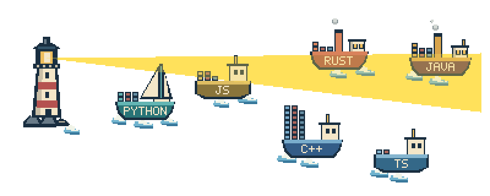

# Advanced guide

For quick setup, see the [README](../README.md).

A little lighthouse for you. A cargo fleet for your languages. Your GitHub README supplies the open sea. Small containers represent one shipped commit; large containers represent four.

<picture>
  <source media="(prefers-reduced-motion: reduce)" srcset="../examples/demo/git-ship.png">
  
</picture>

Git Ship is an open-source **reusable GitHub Action** and Python CLI for anyone's profile. It fetches your public repository data and generates a transparent animated GIF plus a matching static PNG. **Only languages with qualifying commits appear: up to six ships, showing up to 20 commits per ship. One small container represents one commit; one large container represents four commits.** Each regeneration picks fresh positions across the sea and shuffles ship types; positions and types remain fixed within the seamless animation loop. An optional rotating lighthouse ray sweeps a solid yellow cone across the scene and tints the artwork it crosses. A small optional watermark at the top left names Git Ship and the selected period. Regenerate automatically every day and choose a **1-day, 7-day, 30-day, or 365-day** activity window. No hosted application, external image service, or personal access token is needed for the normal setup.

Use `PingPongPlus/git-ship@main` for the current source action, or pin a reviewed full commit SHA for a stable installation.

## Set up daily updates with GitHub Actions

1. Open your public profile repository: `YOUR_USERNAME/YOUR_USERNAME`.
2. Add the workflow below as `.github/workflows/git-ship.yml` on its default branch. The complete file is also available in [examples/profile-workflow.yml](../examples/profile-workflow.yml).
3. Allow GitHub Actions to run. Repository/organization rules must permit this job's `contents: write` permission and pushes to the **`output`** branch.
4. Run **Actions → Git Ship → Run workflow** once. Choose `day`, `week`, `month`, or `year`.
5. Add the README image shown below, replacing both username placeholders.

```yaml
name: Git Ship
on:
  schedule:
    - cron: '23 3 * * *' # Every day at 03:23 UTC.
  workflow_dispatch:
    inputs:
      period:
        description: Activity and cargo data window
        type: choice
        options: [day, week, month, year]
        default: month

permissions:
  contents: read

concurrency:
  group: git-ship-output
  cancel-in-progress: false

jobs:
  fleet:
    runs-on: ubuntu-latest
    timeout-minutes: 15
    permissions:
      contents: write
    steps:
      - uses: actions/checkout@v7
        with:
          persist-credentials: false
      - name: Generate fleet
        id: ship
        uses: PingPongPlus/git-ship@main
        with:
          username: ${{ github.repository_owner }}
          output-dir: git-ship-output
          token: ${{ github.token }}
          data-window: ${{ inputs.period || vars.GIT_SHIP_DATA_WINDOW || 'month' }}
      - name: Publish only images to output branch
        env:
          GITHUB_TOKEN: ${{ github.token }}
          SHIP_PUBLISH_SCRIPT: ${{ steps.ship.outputs.publish-script }}
          SHIP_ASSETS: ${{ steps.ship.outputs.output-dir }}
          SHIP_DEFAULT_BRANCH: ${{ github.event.repository.default_branch }}
        run: |
          set -euo pipefail
          python "$SHIP_PUBLISH_SCRIPT" \
            --assets-dir "$SHIP_ASSETS" \
            --repository "$GITHUB_REPOSITORY" \
            --default-branch "$SHIP_DEFAULT_BRANCH"
```

`main` follows project updates. For a stable installation, replace the branch ref with a reviewed full commit SHA. No `v1` release tag or Marketplace release is claimed yet. Nothing is hard-coded to the project's owner: the example uses **your** repository owner, your workflow token, and your repository's output branch.

### Choose your data window

| Value | Cargo and activity period |
| --- | --- |
| `day` | Previous 24 hours |
| `week` | Previous 7 × 24 hours |
| `month` | Previous 30 × 24 hours, the default |
| `year` | Previous 365 × 24 hours |

The **update schedule and data window are independent**: a fleet with a year of data still regenerates every day. For nightly runs, set repository variable **`GIT_SHIP_DATA_WINDOW`** to `day`, `week`, `month`, or `year` under Settings → Secrets and variables → Actions → Variables. Alternatively, replace the workflow's `data-window:` expression with a fixed value such as `week`. The manual dropdown overrides the variable for that run only. A month means 30 rolling days and a year means 365 rolling days, not calendar boundaries.

For hourly refreshes, change the workflow cron to `'23 * * * *'`. It requests a refresh at minute 23 of every hour; the selected data window stays independent of that schedule.

This window controls which languages appear, authored-commit cargo, repository push-recency movement, and the optional contribution total. **A language needs at least one confirmed qualifying commit to appear.** If more than six qualify, the highest current code-byte shares determine the visible fleet; sizing also uses those byte shares. A quiet window shows only the lighthouse and its small ripples.

Cron defaults to UTC: 03:23 UTC is 04:23 CET / 05:23 CEST. Scheduled workflows must exist on the default branch and can be delayed or dropped during load. Inactive public repositories can have schedules disabled after 60 days. See [GitHub's schedule documentation](https://docs.github.com/en/actions/reference/workflows-and-actions/events-that-trigger-workflows#schedule).

### README image

Replace `YOUR_USERNAME` in **both** owner and repository positions:

```md


[View the still image](https://raw.githubusercontent.com/YOUR_USERNAME/YOUR_USERNAME/output/git-ship.png)
```

For readers who prefer reduced motion, use a static fallback:

```html
<picture>
  <source media="(prefers-reduced-motion: no-preference)"
    srcset="https://raw.githubusercontent.com/YOUR_USERNAME/YOUR_USERNAME/output/git-ship.gif">
  
</picture>
```

Browsers that support the media query animate only with no reduced-motion preference. Other clients receive the PNG. The local [picture proof](../examples/reduced-motion.html) uses the same structure. GitHub sanitization, image caching and client behavior can change; a newly published profile embed still needs checking on GitHub. Use a direct PNG embed for an unconditional still. The local preview includes a pause button; a standalone README GIF does not.

## Huge Cargo Ship

Enable this optional mode in the generation step:

```yaml
huge-cargo-ship: 'true'
```

It replaces the language fleet with one heavy ship carrying the **exact combined
number of unique authored commits** in the selected period. It includes
documentation-only commits and repositories without language bytes. A commit
touching several languages, or shared between repositories, is counted once.
Public, owned repositories and the configured fork/archive/include/exclude filters
still define the data scope; default-branch history and linked author identity are
used. The standard fleet's per-language 20-commit cap does not apply here.

Each large container represents **six commits**. Up to five leftover commits use
small containers, one commit each. The deck holds 30 large containers; when more
are needed, the hull retains the exact total and a **`+N` overflow count** shows
the remaining commits. Container weights never change to hide overflow. With no
qualifying commits, only the lighthouse and enabled decorations remain.

The approved 300×110-pixel hull sits low against its red waterline. A calm,
irregular displacement wake and low bow curl roll once per animation loop, with
small mooring motion and no airborne spray. The lighthouse beam and watermark
remain independently configurable. This ship is separate from the standard
random design pool.

```sh
git-ship render --username YOUR_USERNAME --huge-cargo-ship --data-window month --output-dir out/huge
git-ship render --demo --huge-cargo-ship --seed huge-demo --preview --output-dir examples/huge-demo
```

Use `huge_cargo_ship = true` in TOML, or `--no-huge-cargo-ship` to override it off.
The mode defaults to off. Its separate [demo](../examples/huge-demo/preview.html)
shows 44 fixture commits as seven large containers and two small containers.

The default huge mode classifies changed files even without container symbols,
so its total counts programming and scripting commits rather than README/config
edits. Only `include-non-code: 'true'` with symbols disabled uses the faster
metadata-only scan without language or file-detail calls.
Schema-3 caches record coverage, observation time, window and repository filters.
Sampled fleet caches without a separately scanned `commit_total`, and schema-1/2
caches, cannot establish an exact aggregate total: fetch a fresh profile with
`--huge-cargo-ship` or `--display-commits`. Keep the huge-mode flag when
rendering its metadata-only cache; a language fleet needs a fresh classified
profile. Changed observation/window/filters also require refetching. Explicit
complete classified fixtures can support both modes.

Enable `cargo-logos: 'true'`, CLI `--cargo-logos`, or TOML `cargo_logos = true`
for the approved Java, Python, JavaScript, Rust, C++ and Git pixel symbols.
Other languages use short labels on neutral panels. The option only affects
Huge Cargo Ship mode and defaults to off; disable with `false` or `--no-cargo-logos`.

Every distinct authored SHA is assigned once. Live scans classify all commits
from changed filenames using the vendored Linguist heuristic. Repository
language data resolves ambiguous extensions; recognizable file types are also
detected when omitted from GitHub's language-byte totals, including Markdown
READMEs, YAML workflows, deleted source languages and build scripts.
The language with the greatest sum of changed lines
wins; ties use alphabetical order. Zero-line changes have weight one, and renames
consider both filenames. By default only Linguist's `programming` category is
eligible, including Shell, PowerShell, Python, JavaScript and other scripting
languages. Documentation, data/config formats, markup (including HTML/CSS/SVG),
and unknown files are excluded. Mixed code-and-doc commits count once and are
assigned to the eligible code language with the most changed lines.

Use `include-non-code: 'true'`, TOML `include_non_code = true`, or CLI
`--include-non-code` to include these other changes; `false` or
`--no-include-non-code` restores the default. In that view Markdown appears as
`MD`, YAML as `YAML`, and genuinely unknown files use `Git`. Ambiguous extensions
without a repository-language match remain unknown rather than guessing.
The filter applies to cargo in the fleet and either huge-ship variant. The
displayed commit counter always counts all authored commits in the selected
period, including documentation/config changes, independently of this filter.
The huge report separates `total_commits` (the counter) from `cargo_commits`
(the commits represented by containers). Overflow applies only to cargo.
Cached live profiles record this scope and require refetching
when it changes; older unscoped caches represent the previous all-commit view.

Full six-commit groups get single-language containers. Leftovers fill mixed
containers marked `MIX`; the last zero to five commits retain small boxes.
The thirty-large-container capacity, exact hull total and overflow remain intact.
Reports record language totals and the contents of every visible container.

Logo-enabled live caches use `complete-file-language` coverage. Plain metadata,
sampled fleet caches, and older `complete-primary-language` caches need
refetching with logos enabled to identify previously unclassified files. These
caches support both huge variants but require refetching for the standard fleet,
which counts multi-language commits on each affected ship. Complete classified
fixtures assign a commit to its alphabetically first language. A classified
duplicate SHA takes precedence over an unclassified copy.
Logo containers fill adjacent supported stacks from left to right, keeping
same-language groups together rather than following the plain ship's center-out layout.

The huge report uses `mode: "huge-cargo-ship"`, `total_commits`, total and displayed
large/small container counts, `overflow_commits`, and
`commits_per_large_container: 6`. `languages` is empty because this vessel represents the combined total.

## Action interface and publishing

| Input | Default / meaning |
| --- | --- |
| `username` | Explicit input → config username → caller repository owner |
| `data-window` | `day`, `week`, `month`, or `year`; empty uses TOML `activity_window`, then 30 days |
| `lighthouse-beam` | `true` or `false`; empty uses TOML `lighthouse_beam`, enabled by default |
| `rain` | `true` or `false`; empty uses TOML `rain`, disabled by default |
| `include-non-code` | `true` or `false`; include docs/config/markup/unknown commits, disabled by default |
| `watermark` | `true` or `false`; empty uses TOML `watermark`, enabled by default |
| `display-commits` | `true` or `false`; empty uses TOML `display_commits`, disabled by default; fleet total at bottom right |
| `huge-cargo-ship` | `true` or `false`; empty uses TOML `huge_cargo_ship`, disabled by default |
| `cargo-logos` | `true` or `false`; language symbols on huge containers, disabled by default |
| `output-dir` | `git-ship-output`, a subdirectory inside the caller workspace |
| `config` | Optional TOML path inside the caller workspace |
| `token` | Built-in `${{ github.token }}`, supplied as `GITHUB_TOKEN` internally |
| `demo` | `false`; `true` renders the offline fixture for verification |

Outputs **`gif`**, **`png`**, and **`output-dir`** are absolute paths. **`publish-script`** is the path of the optional publishing helper. Inputs are passed through environment variables and Python argument arrays, without interpolation into shell code. The composite action selects Python 3.13 and installs this package plus Pillow in a temporary virtual environment. Installation requires network access even when demo **rendering** is offline. Linux and macOS runners with Bash are supported; use `ubuntu-latest` for the example. GitHub Enterprise Server and organization profiles are outside the live-fetch support.

Generation and publishing are separate. The action itself never commits or pushes. The example's publisher creates an isolated temporary repository, writes **only `git-ship.gif` and `git-ship.png`**, preserves unrelated output-branch files, uses non-force pushes, and commits only when images change. It refuses a default branch named `output` and leaves the caller checkout/default branch untouched. GitHub permissions apply to the whole job, so the example job needs `contents: write` for its separate publication step. No other permission is requested. You can instead publish the returned paths using your own strategy.

Use the built-in `GITHUB_TOKEN`. It belongs to the **caller repository**, not to the profile owner as a general account credential. It cannot grant access to unrelated private repositories. Some public REST requests may be rejected because of installation scope; Git Ship retries those public GETs anonymously with a warning and the smaller anonymous rate limit. Invalid tokens (401), primary/secondary limits and failed cargo requests produce clear errors. Optional GraphQL contribution totals may be unavailable to installation tokens; that gentle animation input uses the peaceful baseline with a warning. No cargo is fabricated to hide API failures. See [token permissions](https://docs.github.com/en/actions/tutorials/authenticate-with-github_token) and [REST rate limits](https://docs.github.com/en/rest/using-the-rest-api/rate-limits-for-the-rest-api).

Output commits use `github-actions[bot]` and are not attributed as your authored commits. Cargo reads default-branch history, so output-branch image commits do not load your ships. Publication can still update repository-level `pushed_at`; if your profile repository contains measurable code, exclude it to avoid feedback into that movement proxy.

## What each container means

This section describes the standard language fleet. Huge Cargo Ship uses the
aggregate counting and six-commit containers described above.

Git Ship uses [official repository and commit APIs](https://docs.github.com/en/rest/commits/commits):

1. List public, owned, non-fork repositories; include archived repositories by default. Apply configured repository filters before fetching language bytes.
2. Rank candidate languages by summed reported **byte counts**, with a case-insensitive language-name tie break. These are code shares, not coding time, skill, or authored lines. Filter out zero/unknown qualifying commit counts before applying the six-ship limit, so inactive high-byte languages cannot hide active languages farther down the ranking. Never invent filler ships.
3. List default-branch history for the selected rolling window, then count **your authored commits** by each response's linked `author.login`. Filtering the returned account locally preserves commits made with an old username's noreply address; GitHub's server-side `author=username` filter can omit those even when they resolve to the same account. Use the commit's **committer timestamp**, matching the REST history filter. Unmapped authors and commits by other users do not count. A co-author trailer by itself is not included by this primary-author filter. Merge commits count if returned as your authored commit and they affect a classified language.
4. Read every returned commit's changed-file pages. Assign filenames/extensions using vendored [GitHub Linguist metadata](https://github.com/github-linguist/linguist/blob/73ee9a3b277f398c37ca4ab0dea0193849de6460/lib/linguist/languages.yml), including named files, compound suffixes and language groups. Ambiguous extensions use the repository's largest reported candidate language. A `.C` → C++ override supports the conventional uppercase extension.
5. **Count each distinct commit SHA once per language**, displaying at most **20 commits** per ship. Editing five Python files in one commit increments Python's count once. A commit touching Python and JavaScript increments both language counts. The same SHA across selected repositories is deduplicated. Adds, edits, deletes and renames count; a language-changing rename can affect both the old and new language.

The drawing groups every four commit units into one large container and shows the remainder as small containers: **large = 4 commits, small = 1 commit**. Large containers are marked with a `4`. For a displayed count `n`, `large = n // 4` and `small = n % 4`. Nine commits appear as **two large containers and one small**; twenty commits appear as **five large containers**. The grouping changes only how cargo is drawn; commit attribution, the selected window and the 20-commit display cap are unchanged.

File attribution is a **filename-based heuristic**, not GitHub's full content-aware Linguist engine. It does not evaluate file contents, shebangs, repository `.gitattributes`, vendored/generated-file rules or content disambiguation. Only languages with positive reported bytes in the selected repository are candidates; a language removed entirely from the current snapshot will not create a ship. This limitation is separate from the real commit counts: every commit unit represented by the cargo comes from a fetched authored commit under the stated attribution rule.

Zero matching commits means **no ship for that language**. Unknown cached activity is hidden too. There are no decorative cargo blocks. All seven designs reserve deck space for the grouped containers, keeping the hull name, sails, cabin and smoke clear. Each size class keeps a constant pixel size as stacks grow. The demo's represented commit counts are **JAVA (7)**, **C++ (20)**, **PYTHON (6)**, **RUST (4)**, **JavaScript/JS (5)**, and **TypeScript/TS (2)**.

Ship shape is independent of language. Each generation shuffles seven types—steamship, tug, freighter, sailboat, ferry, fishing trawler and tanker—and selects up to six without repeating a type. Language labels, colors, custom label/color settings and commit cargo remain tied to the actual language. The trawler's suspended hook sways gently as the boat moves.

Fetching considers all candidate languages until it can determine the active fleet, including languages below quiet high-byte candidates. It stops early only when the selected counts are known/capped and higher-ranked candidates cannot change that selection. Larger counts are intentionally represented as **20**, not reported as exact totals. Repository/commit lists are bounded to ten 100-item pages each, commit files to 30 pages, responses to 10 MB, and a run to 2000 HTTP attempts. Reaching GitHub's 3000-file-per-commit limit or a pagination/request limit fails clearly rather than silently undercounting. Narrow repository filters or the data window for large profiles. Public API limits may be lower than these client bounds.

## Run locally, entirely offline if desired

Requires **Python 3.11+** and **Pillow 13.x**, the only runtime dependency. See [Pillow's supported Python versions](https://pillow.readthedocs.io/en/stable/installation/python-support.html). No PyPI release is claimed; install from this source:

```sh
git clone https://github.com/PingPongPlus/git-ship.git
cd git-ship
python3 -m venv .venv # Select a Python 3.11+ interpreter.
source .venv/bin/activate
python -m pip install .
git-ship render --demo --preview --output-dir out
```

```sh
git-ship render --username YOUR_USERNAME --data-window day --output-dir out
git-ship render --username YOUR_USERNAME --data-window week --output-dir out
git-ship render --username YOUR_USERNAME --data-window month --output-dir out
git-ship render --username YOUR_USERNAME --data-window year --output-dir out
git-ship render --config examples/config.toml --output-dir out
git-ship render --username YOUR_USERNAME --cache-profile out/profile.json --output-dir out
git-ship render --profile out/profile.json --output-dir out/offline
```

Replace the example config's username before a live render. Without `GITHUB_TOKEN`, public REST works at GitHub's lower anonymous limit and contribution totals remain unavailable. Never pass tokens on the CLI or put them in configuration. The fixed demo uses 2026-10-01 and works without credentials or network access, even if `GITHUB_TOKEN` is set.

Open `out/preview.html` directly or serve it with `python -m http.server 8000` and visit `http://localhost:8000/out/preview.html`. It shows the same transparent GIF on light/dark backgrounds at 800/400 px. Preview backgrounds never enter exported artwork.

| File | Purpose |
| --- | --- |
| `git-ship.gif` | Transparent endlessly looping animation |
| `git-ship.png` | Transparent static frame zero |
| `report.json` | Dimensions, timing, size, transparency, window days, beam/watermark settings, watermark text, ship positions/types, commit and container counts, and replayable layout seed |
| `preview.html` | Optional light/dark playback and pause control |
| `contact-sheet.png` | Optional four-time-point verification sheet |

The report keeps each language's `cargo` as its displayed commit count, with `large_containers` and `small_containers` describing the drawing. The top-level `commits_per_large_container` is `4`.

Normalized schema-3 profiles record commit coverage and repository filters alongside public repository data, commit SHAs/authors/timestamps, the observation instant and cargo window; never credentials or patches. Schema-1/2 caches remain readable for the standard fleet but cannot establish complete aggregate totals. Since standard scans can stop at the 20-commit cap, refetch when changing a cached data window, observation date, repository filters, or visible fleet. Ships with unknown activity are omitted with a warning. A fixed observation date freezes calculation time at that date's end in UTC, not GitHub history: cache a profile and provide `--seed` for fully repeatable historical rendering.

## Customize

[examples/config.toml](../examples/config.toml) lists all options. CLI flags override TOML. Action inputs override the corresponding TOML values. `--data-window day|week|month|year` is shorthand for `--activity-window 1|7|30|365`; the two flags are mutually exclusive.

| Key | Default | Bounds / behavior |
| --- | --- | --- |
| `username` | empty | Required live; a GitHub user login |
| `ships` | 6 | 0–6, limited to languages with confirmed qualifying commits |
| `activity_window` | 30 | Rolling days, 1–365; friendly presets are 1/7/30/365 |
| `scale` | 2 | Integer 1–4; 400×160 logical grid, nearest-neighbor export |
| `fps` | 10 | 5, 10, 20 or 25, all exact GIF centiseconds |
| `duration` | 10 | Integer seconds, 2–20; at most 300 frames |
| `seed` | fresh random value | Optional string/integer to reproduce positions and ship types; omit for a fresh fleet on each run |
| `lighthouse_beam` | true | Rotating lighthouse ray; set false to disable |
| `rain` | false | Slanted pixel rain and miniature ocean impact ripples in either ship mode |
| `include_non_code` | false | Count only programming/scripting by default; true also includes non-code commits |
| `watermark` | true | Top-left Git Ship and data-period label; set false to disable |
| `display_commits` | false | Full commit total at the bottom right of the standard fleet |
| `huge_cargo_ship` | false | One aggregate ship with six-commit large containers; replaces the standard fleet |
| `cargo_logos` | false | Language symbols on the huge ship; adds changed-file requests per commit |
| `observation_date` | current instant live | ISO/TOML date; override uses end of that UTC date; offline uses its fixture instant/date |
| `include_forks` | false | Include owned public forks when explicitly enabled |
| `include_archived` | true | Archived code contributes by default |
| `include` | `[]` | Empty means all; otherwise case-insensitive repository globs |
| `exclude` | `[]` | Exclusions win; short name or `owner/name` globs |
| `[labels]` | language mapping | 1–6 uppercase letters/digits or `+ # space . -` |
| `[colors]` | language mapping | `#RRGGBB`; bright colors become trim with a darkened hull |

To disable the ray, add `lighthouse-beam: 'false'` under the action's `with:` block, set `lighthouse_beam = false` in TOML, or pass `--no-lighthouse-beam` to the CLI. Use `--lighthouse-beam` to enable it explicitly. The setting does not change cargo counts or ship placement.

The watermark reads **`GIT SHIP — COMMITS FROM THE PAST MONTH`** for the month preset. It follows the selected day, week, month or year window; a custom window uses its number of days. It uses the project's uppercase pixel font and gray lettering at the top left. To hide it, set the action input `watermark: 'false'`, use `watermark = false` in TOML, or pass `--no-watermark`. `--watermark` enables it explicitly. This display setting does not change commit counts.

Enable rain with the action input `rain: 'true'`, TOML `rain = true`, or CLI
`--rain`. Set `false` or use `--no-rain` to disable it. Rain works with the fleet,
Huge Cargo Ship, and quiet scenes; it defaults to off. [Animated example](../examples/rain-demo/git-ship.gif).

The approved effect uses up to 44 seeded drops, with five fall-and-impact cycles
per animation loop. Each slanted drop ends in a tiny splash and a short expanding
ripple. Impact footprints avoid land, moving hull envelopes and the optional
commit footer. Ships and existing art occlude the weather; the lighthouse beam
then lights it, with captions drawn last. All pixels keep binary transparency.
Rain has its own random stream and changes no cargo, data window or placement.
The export report records `rain`. The approval snapshots and native-grid source
are documented in [the rain artwork notes](../artwork/rain/README.md).

Enable `display-commits: 'true'`, `display_commits = true` in TOML, or
`--display-commits` to show the standard fleet's full commit total at the bottom
right. Disable it with `false` or `--no-display-commits`. This is independent of
the watermark and reserves space below the ships. It counts distinct authored
commits across all selected public repositories in the selected period, including
docs-only commits regardless of `include-non-code`, without the 20-container
limit or mixed-language duplicates. Enabling the total adds a complete scan;
schema-3 caches save its total with
the observation instant, window and repository filters. Older sampled caches
must be fetched again. Huge Cargo Ship keeps its existing total on the hull.

Abbreviations include JS, TS, IPYNB, and OBJ-C. Unknown names use an uppercase ASCII approximation truncated to six characters; configure labels to avoid collisions. Full language names remain in the report. Unknown languages receive deterministic color variants and participate in the same shuffled ship-type pool. An inactive window keeps the lighthouse, its optional ray and localized ripples, with no idle ships. Total export workload is capped at **80 million frame-pixels** before allocation; not every otherwise-valid scale/fps/duration combination fits. RGBA, indexed and verification frames make peak memory several times the pixel count.

## Exact activity and animation formulas

Let `T` be the stored UTC observation instant and `W` the chosen day count. Live time windows are `(T - W×24 hours, T]`. Offline fixtures without an instant use the end of their observation date; an explicit `--observation-date` does the same. Language-specific motion phases are seeded from SHA-256 of the case-folded username and language name, preserving identity independently of placement.

For language `L`, `B[L] = sum(selected_repo_bytes[L])`, and `share[L] = B[L]/sum(B)`. For repository `R`, `age[R] = (T - pushed_at[R])/86400 seconds`, and `recency[R] = max(0, 1 - age[R]/W)` for a present, nonfuture timestamp; otherwise zero. `activity[L] = sum(bytes[R,L]*recency[R])/B[L]`. This movement input is a **repository-level last-push proxy**, including pushes by other users and to other languages; cargo uses the separate authored-commit/file pipeline above.

The optional [GraphQL contribution calendar](https://docs.github.com/en/graphql/reference/users#contributionscollection) is requested for the same chosen interval. GitHub defines its contribution types, daily calendar aggregation and token visibility; it is not a precise per-language commit counter. Clamp `energy = min(total,1000)/1000`; unavailable totals stay null and use energy zero with a warning. Language bytes are not time-windowed.

Each render samples positions throughout the sea to the right of the lighthouse, rejecting placements whose full wake/drift/bob/smoke envelopes overlap or leave the canvas. Bounded retries keep layout work finite; dense fleets fall back to randomized column widths and independent vertical splits that guarantee room. Hull width is `min(round(44 + 16*sqrt(share)), 62)`, so names and cargo stay readable even with six ships. A fresh random seed is chosen **once per render**, never per frame. A separate shuffle derived from that seed assigns ship types without changing placement randomness. `report.json` stores `layout_seed`, ship coordinates and each language's `design` (`steam`, `tug`, `freighter`, `sail`, `ferry`, `trawler` or `tanker`); pass the seed back through `--seed` with the same profile/config to reproduce positions, types and the GIF. The demo artifacts use `--seed demo`. Refreshing a README replays its existing GIF; a new workflow run generates a fresh fleet.

A 14-pixel header reserves space for the watermark. The label is drawn after the ray, keeping its gray lettering untinted throughout the animation. The report records `watermark` and `watermark_text` alongside the selected activity window.

The lighthouse ray rotates once per loop. Its projected length, tilt and fan width change as it turns toward and away from the viewer. The cone is solid yellow over empty space. Where it crosses existing artwork, its color is blended with the original pixel at **30% yellow and 70% original color**, so the light and underlying ship, label or wave remain visible together. The ray is applied after the scene is drawn; pixels outside it remain unchanged. Disabling it retains the lantern's normal blink.

For normalized loop time `t` and stable phase `p`, horizontal drift is `round((2.5 + 1.5*activity)*sin(2π(t+p)))`; bob is `round((1.2 + 0.8*energy)*sin(4π(t+p)))`. Names and cargo move with the same sprite. Boats face right while surging and easing astern in their small mooring area; there is no offscreen wrap or teleport.

Three blue/white wake clusters cycle three times per loop, visible for phases 0.08–0.78, changing length/crest and drifting left. End crests tuck behind the hull; the middle patch sits below the keel. Two staggered steam/tug puffs cycle three times, visible from phase 0 to 0.86, rising 11 pixels and drifting left 7 pixels. A shared funnel-mouth anchor keeps smoke aligned and the stack connected to the deck. Two localized lighthouse ripples and a tiny lantern cycle twice. Frames sample `i/frame_count`; no extra closing-frame hold is appended.

The trawler's hook swings from a fixed boom tip by one or two logical pixels, depending on hull width. Its rope stays connected, and the movement repeats exactly at the loop boundary. The hook receives the same lighthouse tint as the rest of the boat when the ray crosses it.

PNG has real binary RGBA alpha. The ray's tint is preblended into RGB while its pixels remain fully opaque, keeping the same result in GIF. GIF uses one exact shared palette, transparency index **0**, full-frame image blocks and **disposal 2**, with optimization disabled. Outside the ray and scene artwork, the sea and sky remain transparent; no matte, quantization, antialiasing or checkerboard is drawn. Pillow's public GIF block helpers preserve identical adjacent frames in quiet scenes. Every saved GIF frame is decoded and compared against intended alpha and visible RGB, including vacated pixels, before images replace existing assets. See [Pillow's GIF options](https://pillow.readthedocs.io/en/stable/handbook/image-file-formats.html#gif).

Current six-ship demo with grouped cargo, randomized ship types, the solid ray and watermark enabled: **800×320**, **100 frames**, **10 fps**, **10 seconds**, **986,128 GIF bytes**; PNG **7,036 bytes**. Every frame is **74.30–84.32% fully transparent**. The filled ray occupies additional space as it sweeps; the ray-disabled fleet retains the tested 80% minimum transparency. Sizes may change with source/palette/Pillow versions; `report.json` records actual measurements. The 2 MB target is a warning threshold, not a reason to hide names or cargo. 800 px is recommended; 400 px is the compact proof.

## Develop, test and inspect

```sh
python -m pip install -e '.[dev]'
ruff check .
ruff format --check .
pytest -q
python -m build --no-isolation
python scripts/sprite_atlas.py
git-ship render --demo --seed demo --preview --output-dir examples/demo
```

Ordinary tests use fixtures and local temporary Git repositories, with no live API or push requirement. They cover active-language discovery below inactive candidates, six-ship limits, randomized/replayable layouts and unique ship-type assignments, disjoint full motion envelopes across many seeds, the 20-commit cap and four-to-one cargo grouping, file/commit pagination, renamed-account author attribution, SHA deduplication, time windows, unknown caches, cargo/label clearance, trawler hook motion, beam rotation and its disable setting, the period watermark, loop continuity, exact decoded cleanup, offline CLI/action execution, and isolated output-branch publishing. CI runs on pushes and pull requests with Python 3.11/3.15, lint, tests, package build and an offline render. A separate job invokes the actual local root composite action with `uses: ./` and a selected data window. CI does not publish images or releases. Dependabot checks Actions and Python dependencies monthly. Actions currently use v7 major refs; pin immutable SHAs if required by your policy.

Editable artwork is documented in [artwork/README.md](../artwork/README.md). The renderer separates fetching (`github.py`), normalization/ranking (`model.py`), filename attribution (`languages.py`), validation (`config.py`), safe layout (`layout.py`), pixel art (`sprites.py`, `font.py`), animation (`animation.py`), export/audit (`export.py`) and local proof (`preview.py`). `scripts/run_action.py` runs the same CLI for any caller; `scripts/publish_assets.py` is optional and separate.

The [approved reference](../references/concept-transparent.png) is retained. [Verification notes](verification.md) record actual commands, measurements and remaining external checks.

## Troubleshooting

| Symptom | Check |
| --- | --- |
| Workflow does not run daily | Keep it on the default branch, enable Actions, check schedule inactivity and GitHub delays. Manual execution is available. |
| Nightly period differs from the last manual run | The dropdown is per-run; set `GIT_SHIP_DATA_WINDOW` or a fixed workflow input for the persistent default. |
| 401 | Correct/unset an invalid local `GITHUB_TOKEN`; use `${{ github.token }}` in Actions. |
| 403/429 / rate limit | Retry after reset, narrow repositories/window, and avoid tight retries. Public anonymous fallback has a smaller quota. |
| Contribution total unavailable | Some installation tokens cannot query the calendar; the fleet and real commit cargo still work. |
| Push rejected | Allow job `contents: write` and output-branch updates. Concurrent non-force updates fail clearly and can be retried. |
| Missing/stale image | Run manually, inspect `output`, check both URL username segments, and allow for GitHub's image proxy cache. |
| Few/no ships | Only languages with qualifying commits in the selected period appear. If none qualify, only the lighthouse remains. Unknown cached activity is hidden. |
| Small cargo | Large containers represent four commits each; small containers represent one. Only qualifying default-branch authored commits count, with a 20-commit display cap. |
| Older username's commits missing | Update the workflow's action ref to a current revision and regenerate. Commit identity is checked from linked `author.login`, including old noreply addresses. |
| Unknown cached cargo | Fetch a fresh profile for the chosen window/fleet. Old caches do not contain commit data. |

No private-repository rendering, full Linguist content engine, release decorations, hosted service, APNG/SVG export or automatic account-permission changes are included. Network/5xx errors retry up to three attempts with 1/2-second waits and 30-second request timeouts; limits fail promptly. Failures never silently replace live data with stale cache. This source-based action is usable by public callers; tagging a versioned release and publishing a Marketplace listing are separate steps.

Code and original generated art: [MIT](../LICENSE). The vendored filename mapping derives from GitHub Linguist revision `73ee9a3b277f398c37ca4ab0dea0193849de6460` under its packaged [MIT license](../src/git_ship/assets/linguist-LICENSE.txt); no grammars are bundled.
